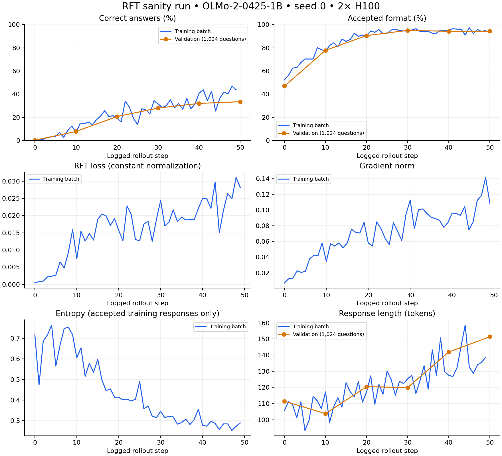

# Post-training experiments

A hands-on learning repository for exploring how language models are trained **after pretraining**: supervised fine-tuning (SFT), rejection fine-tuning (RFT), and reinforcement learning methods such as GRPO.

The goal is to understand the algorithms by implementing them, running small experiments, inspecting generated answers, and comparing rewards, stability, throughput, and GPU cost.
## What we have tried

All training runs so far start from **OLMo-2-0425-1B base** and use **GSM8K** math problems. We have not yet trained a standalone SFT model or run GRPO on an RFT checkpoint.

| Experiment | What it taught us | Observed result |
| --- | --- | --- |
| Nanochat-style on-policy RL on the base model | Group-relative rewards, sampling versus optimization, and the need to inspect verifier failures | Stopped after 131 batches; the last 65 had no correct completions. This used a different objective and optimizer from assignment-standard GRPO. |
| Assignment-style RFT / expert iteration | Generate answers, retain correct ones for supervised token loss, and preserve the original batch normalization | A 50-step, single-seed run improved validation correctness from **0.29% to 33.50%** on 1,024 questions. |
| Two-H100 versus two-B200 RFT benchmarks | Separate inference, update, startup, and persistence costs; measure hardware rather than infer speed from specifications | Three-step workloads took **104.65 s on H100s** and **166.86 s on B200s**. Generation speed was similar; H100 was cheaper for this measured workload. |

These are learning experiments, not controlled evidence that one algorithm is universally better. The older RL and newer RFT runs differ in several settings. The hardware benchmarks are short and train on few accepted responses. Four-seed comparisons remain future work.

## What we learned about post-training

- **Rollouts are generated by the current policy.** In the two-GPU setup, GPU 0 trains the model and GPU 1 runs a vLLM replica. We synchronize weights and reset inference caches before generating new rollouts.
- **A batch contains multiple problems.** The current recipe uses 32 questions with 8 responses each: 256 completions per rollout batch. Gradient accumulation combines microbatches into one optimizer update.
- **RFT and GRPO use rewards differently.** RFT trains on correct completions. Standard GRPO compares rewards within each question's group and normalizes advantages. Our earlier nanochat-style variant omits standard-deviation normalization.
- **Formatting and verification matter.** A model can fail to receive reward because its answer is wrong or because its output does not satisfy the grader's format. We log these separately.
- **Save rejected answers too.** The older run lacked original rollout text, which limited diagnosis. New runs persist all training/evaluation completions and verifier results before updates, plus model/optimizer checkpoints.
- **More expensive GPUs need measured justification.** Two B200s cost about 1.58× as much per GPU-hour as two H100s at the rates checked. Our short benchmark did not achieve that speedup.

## Results and code

- [Concise run history](olmo-modal-rl/RUN_HISTORY.md)
- [Charts and exported W&B metrics](olmo-modal-rl/charts/README.md)
- [RFT / GRPO implementation and setup](olmo-modal-rl/ASSIGNMENT_RFT.md)
- [GPU benchmark details and limitations](olmo-modal-rl/BENCHMARK_RESULTS.md)
- [Earlier nanochat-style implementation and adaptations](olmo-modal-rl/PARITY.md)
- [RFT training run on W&B](https://wandb.ai/alephnott/olmo-gsm8k-assignment/runs/p2wswixp)

## Running experiments

Use **uv and Python 3.13**. Installation, tests, credentials, and explicit Modal launch commands are documented in [the setup guide](olmo-modal-rl/ASSIGNMENT_RFT.md). The training image includes CUDA 12.9.1, Torch 2.10, and vLLM 0.19.1. Python 3.13 with PyTorch SDPA is a deliberate difference from the assignment's published Python 3.12 / FlashAttention environment.

Training runs use paid Modal GPUs and must be launched explicitly. Keep credentials in secure runtime settings and Modal secrets, never in Git. Checkpoints and raw rollouts remain in Modal Volumes; this repository contains code, metric exports, and charts, not model weights or secrets.

## Next experiments

1. Validate assignment-standard on-policy GRPO from the same base model with a roughly 50-step sanity run.
2. Compare RFT and GRPO over 200 steps with four seeds and plots showing variation across runs.
3. Explore RFT → GRPO as a separate experiment, distinct from the base-model comparison.
4. Investigate prompt changes, learning rates, and additional on/off-policy variants.

## References and attribution

Inspired by [Karpathy's nanochat](https://github.com/karpathy/nanochat) and [Stanford CS336 Assignment 5](https://github.com/stanford-cs336/assignment5-alignment). Pinned references and adaptations are documented in [PARITY.md](olmo-modal-rl/PARITY.md), [vendor notices](olmo-modal-rl/vendor/NOTICE.md), and the [vLLM helper notice](olmo-modal-rl/vendor/ASSIGNMENT_VLLM_NOTICE.md). Third-party license files are retained alongside vendored code.
