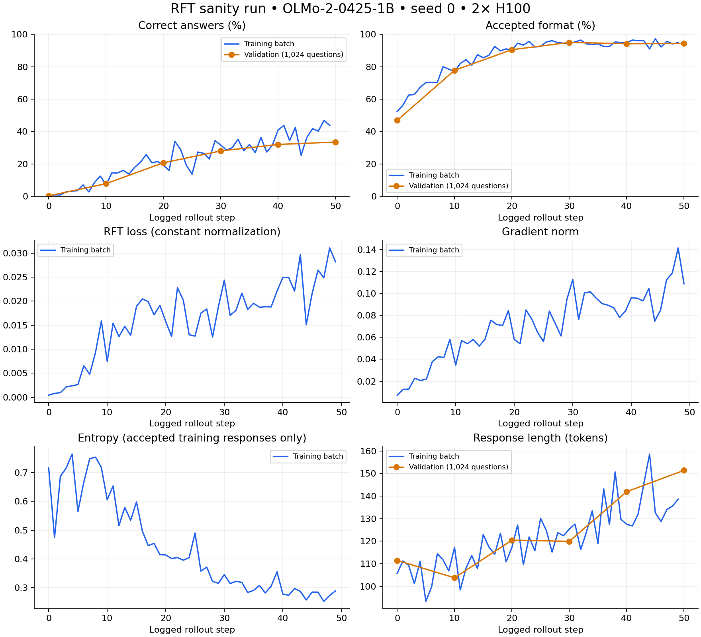
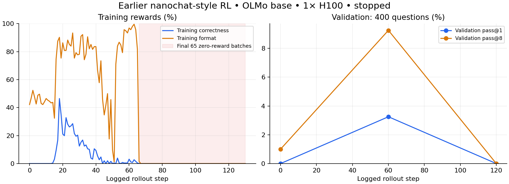
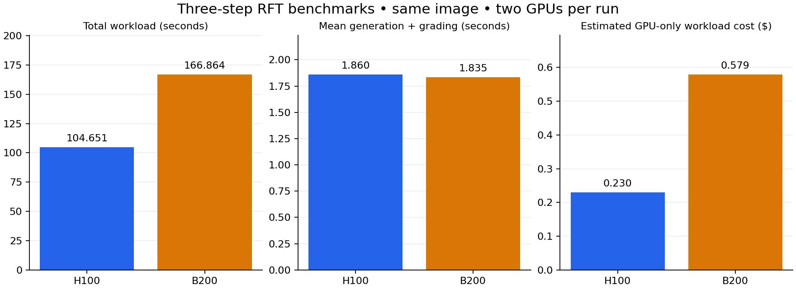

# Experiment charts

Static plots rendered from **full, unsampled W&B API histories**, exported November 25, 2026. These are regenerated charts, not screenshots of W&B dashboard panels. Curves are unsmoothed; lines connect logged observations. Numeric metric exports are in `data/`.

| Source run | W&B | Exported rows |
| --- | --- | ---: |
| RFT sanity, 50 steps | [p2wswixp](https://wandb.ai/alephnott/olmo-gsm8k-assignment/runs/p2wswixp) | 51 |
| Earlier nanochat-style RL, stopped | [w9vc0c3v](https://wandb.ai/alephnott/olmo-gsm8k-nanochat-rl/runs/w9vc0c3v) | 131 |
| H100 benchmark, 3 steps | [fgkoyxj4](https://wandb.ai/alephnott/olmo-gsm8k-assignment/runs/fgkoyxj4) | 4 |
| B200 benchmark, 3 steps | [hnlrh0lb](https://wandb.ai/alephnott/olmo-gsm8k-assignment/runs/hnlrh0lb) | 4 |

## RFT sanity run



Validation correctness rose from **3/1,024 (0.29%) to 343/1,024 (33.50%)**. Validation at step 0 precedes training; step 50 evaluates the final updated policy. Training metrics at step 0 describe the first rollout/update. Entropy covers accepted training responses only. This is one seed, with no cross-seed uncertainty estimate. Rising RFT loss can reflect more accepted responses under a fixed denominator; it is not directly comparable to the earlier RL loss.

## Earlier nanochat-style RL



The final 65 training batches (steps 66–130) had zero correctness reward. Validation was only logged at steps 0, 60, and 120. This run used a different objective, optimizer, sampling setup, and evaluation subset; the two learning curves are not a controlled algorithm comparison. Original rollout text was not retained for this older run.

## GPU benchmarks



Each benchmark ran three RFT steps and used 32 validation questions. Total workload includes startup, evaluations, and checkpoint saving, but excludes queue/image-build time. Costs use $0.001097/H100-second and $0.001736/B200-second, billing both GPUs; CPU, RAM, storage, and other attempts are excluded. These are estimates, not invoices. H100 accepted 5 training responses versus B200's 8; startup and persistence also vary, so this is not a mature-policy throughput prediction.

## Reproduce

From `olmo-modal-rl`, using Python 3.13 and uv:

```bash
UV_CACHE_DIR=/workspace/.cache/uv MPLCONFIGDIR=/tmp/nanochat-mpl \
  uv run --no-project --python 3.13 --with matplotlib==3.10.8 python charts/render.py
```

No credentials are needed to render the checked-in metric exports.
